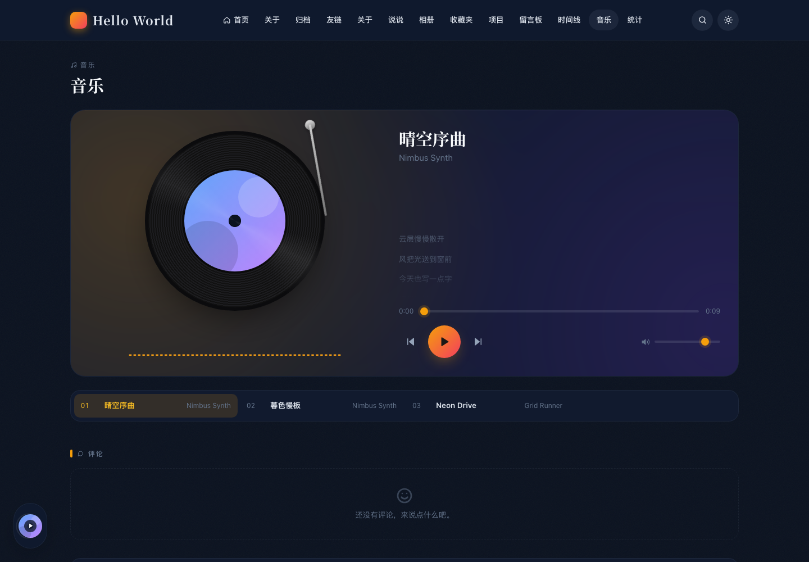
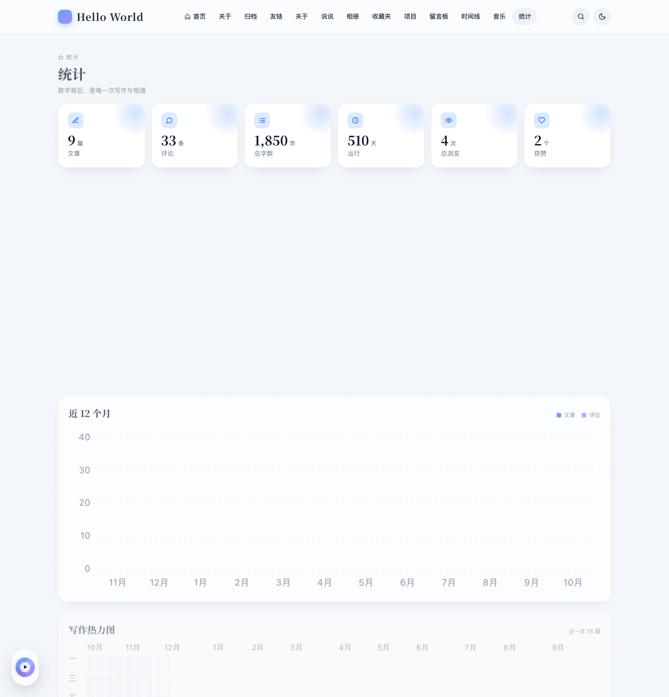
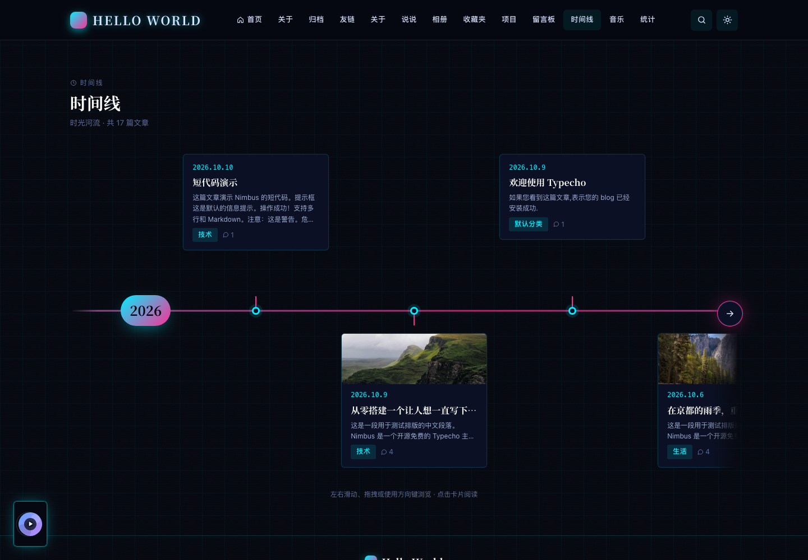
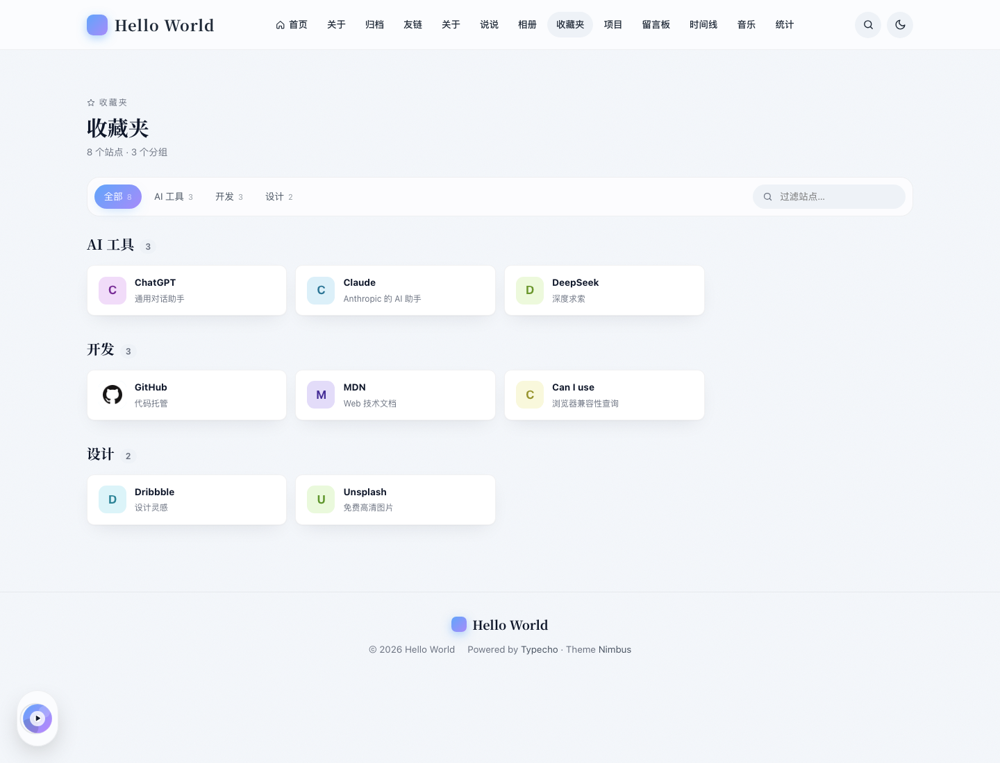

# Nimbus

一个开源免费的 Typecho 主题。三套皮肤、精致动效、零构建、零插件依赖，上传即用。

> 设计灵感来自 Cuteen，代码完全独立实现。MIT 许可。

| 晴空 | 暮色 | 赛博朋克 |
| --- | --- | --- |
|  |  |  |

| 文章 | 音乐 | 统计 | 时间线 | 收藏夹 |
| --- | --- | --- | --- | --- |
|  |  |  |  |  |

## 特性

- **三套皮肤**：晴空（白天）、暮色（夜间）、赛博朋克。一键切换，首屏无闪烁，可跟随系统。
- **首页**：默认「杂志」风格：全屏极光封面（超大渐变标题、行动按钮、站点数据、随鼠标倾斜的 3D 最新文章卡片堆、分类标签滚动条）+ Bento 精选网格（精选文章、作者、写作节奏、最新说说、音乐）+ 通栏文章网格；也可切回「经典」风格（Hero 大图、置顶轮播、侧栏）。三种列表样式、传统分页 / 加载更多 / 无限滚动。
- **自适应版面**：内容宽度随屏幕放大（最宽 1760），大屏不留大片空白；有头图的文章使用通栏沉浸式标题，超宽屏为「目录｜正文｜侧栏」三栏，正文保持易读行宽，图片、代码、表格铺满正文列。
- **文章页**：默认「杂志」布局：与首页一致的封面（有配图用配图，没有用极光背景）、悬浮正文卡片、左侧操作栏（点赞 / 评论 / 海报 / 复制链接 / 阅读进度）、右侧目录、编号小标题与引言式引用；也可选沉浸或经典布局。浮动目录、阅读进度、字数与阅读时长、代码高亮（行号、复制、折叠、语言标签）、KaTeX 公式、Mermaid 图表、图片灯箱、版权卡、打赏、分享、上一篇 / 下一篇、相关文章、过期提醒、密码保护美化。
- **评论**：楼中楼、博主标识、UA 显示、表情面板、Markdown 预览、Ctrl+Enter 提交。
- **页面模板**：归档时间线、友链卡片、关于页、404、留言板（卡片墙）、横向时间线、音乐、统计看板；配合 NimbusKit 还有说说、相册、收藏夹（网址导航）、项目展示。
- **短代码**：提示框、折叠块、标签页、按钮、HTML5 视频、B 站视频、GitHub 仓库卡片、回复可见（服务端不输出隐藏内容）。
- **音乐**：全站悬浮播放器 + 音乐页（黑胶唱片、频谱、LRC 歌词），无刷新切换页面不中断播放；支持自定义歌单与 Meting 接口。
- **分享海报**：文章一键生成带二维码的分享图，可下载。
- **中英双语**：前台界面可选中文、English 或跟随浏览器。
- **赛博朋克特效**：字符雨、标题故障、霓虹描边、鼠标拖尾、副标题解码，可逐项开关。
- **Live2D 看板娘**：可选，从 CDN 加载，Nimbus 不打包任何相关文件。
- **侧栏小部件**：作者卡、公告、热门文章、最新评论、标签云、分类、日历、站点信息、自定义 HTML，顺序可配。
- **全局**：悬浮胶囊导航、多级菜单、移动端抽屉、搜索弹窗（Ctrl/Cmd+K）、无刷新页面切换（View Transitions）、返回顶部进度环、哀悼模式、ICP / 公安备案、自定义头尾代码与 CSS / JS、CDN 前缀、SEO（OpenGraph / JSON-LD）。
- **零构建**：仓库里的文件就是运行文件，想改样式直接改 CSS 变量。

## 安装

1. 要求：Typecho 1.2.1+，PHP 7.4 – 8.4。
2. 下载本仓库，把 `Nimbus` 目录放到 `usr/themes/` 下（目录名必须是 `Nimbus`）。
3. 后台「控制台 → 外观」启用 Nimbus，然后在「设置外观」里按需配置。

可选：安装配套插件 **[NimbusKit](../NimbusKit/)** 解锁浏览量、点赞、即时搜索、AJAX 评论、邮件通知、说说、友链管理、相册、收藏夹、项目展示、GitHub 登录评论、评论者 IP 属地、浏览量趋势与 Sitemap。未安装时这些功能自动隐藏，主题其余功能不受影响。

## 配置速查

后台「设置外观」分为七组，页面顶部可**导出 / 导入配置**（JSON 文件，导入后确认再保存）：

| 分组 | 主要选项 |
| --- | --- |
| 站点 | 前台语言、Logo、Favicon、副标题、建站日期、备案号、作者头像 / 昵称 / 签名、社交链接、页脚 HTML |
| 首页 | 首页风格（杂志 / 经典）、Hero 背景来源（自定义 / 每日必应）、Hero 开关 / 背景图 / 高度 / 标题 / 副标题 / 胶囊文字、置顶文章、列表样式、分页方式、摘要字数、默认缩略图池 |
| 文章 | 文章页布局（沉浸 / 经典）、字数 / 阅读时长、目录、代码行号 / 折叠、版权、打赏二维码、分享、相关文章、过期提醒、灯箱、公式、图表 |
| 侧栏 | 位置、小部件顺序、公告、热门数量、自定义小部件 |
| 外观 | 版面宽度（自适应 / 宽屏 / 标准）、亮 / 暗皮肤、跟随系统、允许切换、字体方案、圆角、动效强度、赛博朋克特效、哀悼模式 |
| 媒体 | 音乐播放器（歌单 / Meting 接口、自动播放）、Live2D 看板娘 |
| 高级 | CDN 前缀、自定义头 / 尾代码、自定义 CSS / JS、无刷新切换、自定义菜单、Gravatar 镜像、调试 |

**Hero 主标题**：用 `|` 分成两段，后段带流光效果，例如 `给时光|以生命`。

**社交链接**：每行 `名称|链接|图标`，图标可选 `github weibo bilibili twitter email rss qq wechat telegram zhihu link`。

**小部件顺序**：每行一个名称，行首 `#` 临时关闭。可用：`author notice hot recent-comments tags categories calendar site-info custom-html`。

**自定义菜单**（JSON）：

```json
[
  {"title": "分类", "url": "/category/", "icon": "folder", "children": [
    {"title": "技术", "url": "/category/tech/"}
  ]},
  {"title": "GitHub", "url": "https://github.com/you", "icon": "github"}
]
```

## 页面模板

在后台新建独立页面时选择对应模板：

- **归档**（`page-archives.php`）：按年月分组的时间线。
- **友链**（`page-links.php`）：在页面的「友链数据」自定义字段填入 JSON：

  ```json
  [{"name": "Typecho", "url": "https://typecho.org", "avatar": "https://typecho.org/favicon.ico", "desc": "轻量开源博客程序"}]
  ```
- **关于**（`page-about.php`）：大头像 + 社交 + 正文。
- **说说**（`page-moments.php`）：时间线展示后台发布的说说（需 NimbusKit）。
- **相册**（`page-albums.php`）：相册卡片与照片网格（需 NimbusKit）。
- **收藏夹**（`page-bookmarks.php`）：分组标签 + 即时过滤的网址导航（需 NimbusKit）。
- **项目**（`page-projects.php`）：封面、技术栈标签、演示 / 源码链接（需 NimbusKit）。
- **留言板**（`page-messages.php`）：表单置顶、留言卡片墙。
- **时间线**（`page-timeline.php`）：文章、系列教程（开始连载的时间点）与项目（需 NimbusKit）按年份排在纵向中轴两侧，可按类型筛选；教程里的文章标出「第 N 章」；中轴随滚动点亮，手机上中轴靠左。
- **音乐**（`page-music.php`）：与悬浮播放器共用同一个播放器，需在「媒体」里开启并填写歌单。
- **教程**（`page-tutorials.php`）：列出全部系列教程。
- **统计**（`page-stats.php`）：文章 / 评论 / 字数统计、月度柱状图、写作热力图、分类环形图；装 NimbusKit 后加上浏览量趋势与热门文章。

**歌单格式**（「媒体 → 自定义歌单」）：每行 `歌名|歌手|音频URL|封面URL|歌词URL`，后两项可省略，`#` 开头的行忽略。歌词为 LRC 文件。音频与网站同源时音乐页显示真实频谱，跨域音频显示模拟动画（不影响播放）。

## 系列教程

把一个分类当作教程：在「首页 → 教程分类」里每行填一个分类缩略名（可加 `|封面图 URL`）。

- 杂志风首页出现「系列教程」区块，教程页面模板列出全部教程，卡片显示章节数、阅读时长与访客自己的学习进度。
- 该分类的归档页变成课程目录：按章节编号排列，已读的章节打勾，按钮会指向下一章未读的内容。
- 教程里的文章显示「第 3 / 10 章」与可折叠的章节导航，文末是上一章 / 下一章。
- 章节顺序：文章自定义字段 `chapter`（数字）优先，否则按发布时间从早到晚。学习进度只存在访客浏览器里，不需要登录。

## 短代码

在文章 Markdown 里直接书写，代码块里的短代码不会被解析：

| 短代码 | 效果 |
| --- | --- |
| `[tip type="info"]…[/tip]` | 提示框，type 可选 `info` `success` `warning` `danger` |
| `[collapse title="标题" open]…[/collapse]` | 折叠块，`open` 表示默认展开 |
| `[tabs][tab title="A"]…[/tab][tab title="B"]…[/tab][/tabs]` | 标签页 |
| `[button url="https://…" type="ghost"]文字[/button]` | 按钮，type 可选 `primary` `ghost` |
| `[video src="…" poster="…"]` | HTML5 视频 |
| `[bilibili bv="BV1xx411c7mD" page="1"]` | B 站视频 |
| `[github repo="typecho/typecho"]` | GitHub 仓库卡片（浏览器读取 GitHub 接口，缓存 6 小时） |
| `[hide]…[/hide]` | 回复可见：本文作者与「贡献者」以上的登录用户可见；访客在本文评论并通过审核后，在同一浏览器可见（装了 NimbusKit 时用签名 cookie 校验，未装时校验邮箱与评论 IP）。RSS、摘要、搜索结果中都不出现 |

安装 NimbusKit 后，友链页优先显示插件后台管理的友链。

## 文章自定义字段

| 字段 | 说明 |
| --- | --- |
| `thumb` | 缩略图 URL，留空自动取正文首图，再回落到缩略图池 |
| `summary` | 自定义摘要 |
| `expireNotice` | 覆盖全局过期提醒天数，0 关闭 |
| `passwordHint` | 密码保护文章的提示语 |
| `nimbusHide` | 多选：隐藏标题 / 目录 / 版权 / 打赏 |

## 皮肤与定制

皮肤只是一组 CSS 变量，位于 `assets/css/theme-*.css`。改颜色直接改变量；想新增皮肤，复制一份文件并改选择器 `:root[data-theme="your-name"]`，再在后台「自定义 CSS」里引入或直接加入 `nimbus.css`。

URL 加 `?nimbus_theme=cyber` 可强制并记住某个皮肤，便于分享。

## 多语言

「站点 → 前台语言」可选中文、English 或跟随浏览器。翻译文件是 `lang/en.php`，键就是源码里的中文原文；新增一种语言只需复制一份并在 `core/I18n.php` 里登记。后台设置页保持中文。开启了页面缓存或 CDN 缓存 HTML 的站点请选择固定语言。

## 开发与测试

```bash
bash tests/serve.sh         # 启动本地测试站 http://localhost:8099（首次自动安装 Typecho 并灌入示例数据）
bash tests/dev-site.sh      # 仅重建 / 补齐测试站与示例数据
bash tests/lint.sh          # php -l + PHP 7.4 语法检查
php tests/run.php           # 单元测试
node --test tests/js/*.test.mjs
bash tests/css-vars.sh      # 皮肤变量完整性
bash tests/smoke.sh         # 页面渲染冒烟测试（插件启用时也检查插件接口）
bash tests/multi-db.sh      # 在临时 MySQL / PostgreSQL 上安装并测试（需本机装有两者）
bash tests/github-flow.sh   # GitHub 登录评论端到端测试（本地假 GitHub 服务器）
bash tests/hide-flow.sh     # 回复可见端到端测试（伪造 cookie、评论解锁、原生搜索）
node tests/shot.mjs out.png http://localhost:8099/ 1440 1200   # 无头 Chrome 截图
```

## 致谢

- Typecho 团队
- Cuteen 主题（设计灵感）
- Prism、KaTeX、Mermaid、Noto Serif SC（见 `assets/vendor/*/LICENSE` 与 `assets/fonts/LICENSE.txt`）
- 二维码编码器为自写实现，参考 ISO/IEC 18004；IP 属地数据格式来自 [ip2region](https://github.com/lionsoul2014/ip2region)（数据文件需自行下载）

## 许可

MIT © Nimbus Contributors
