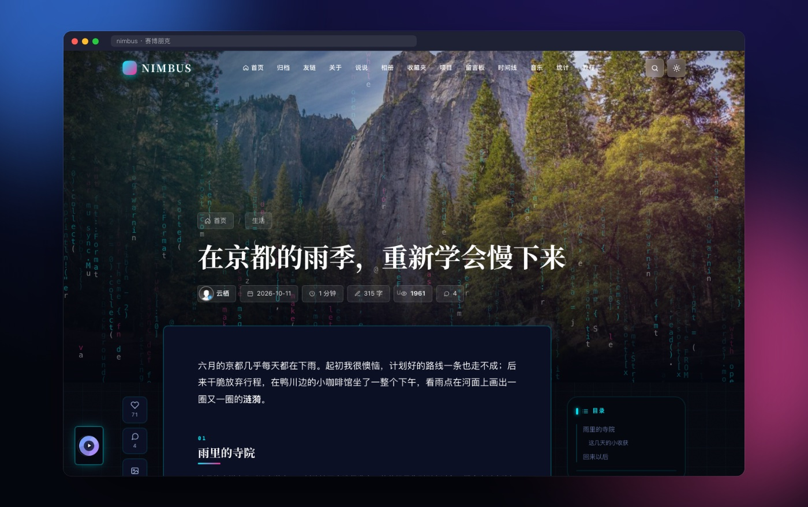
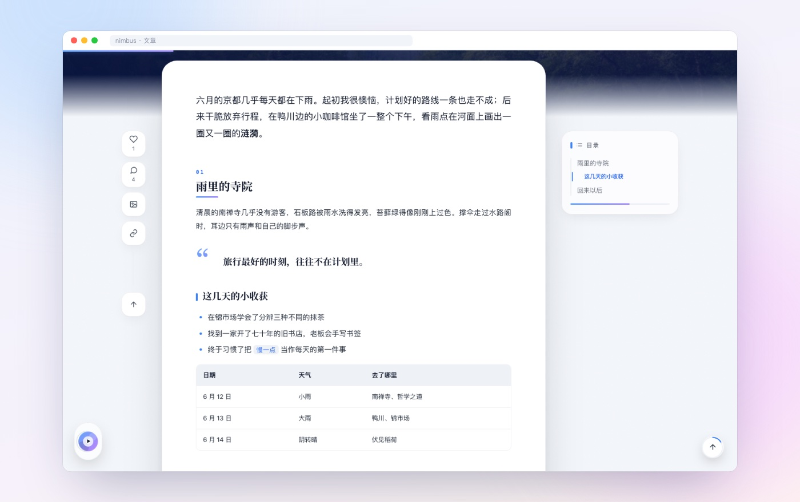
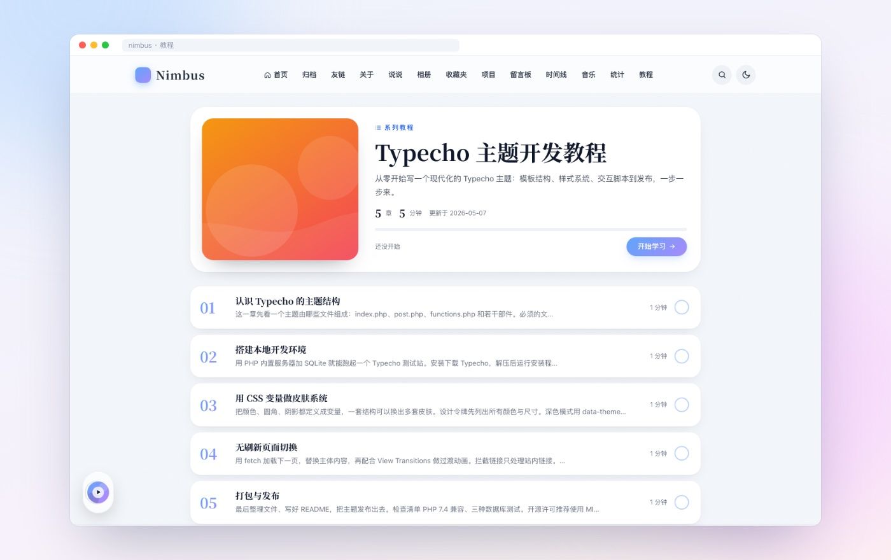
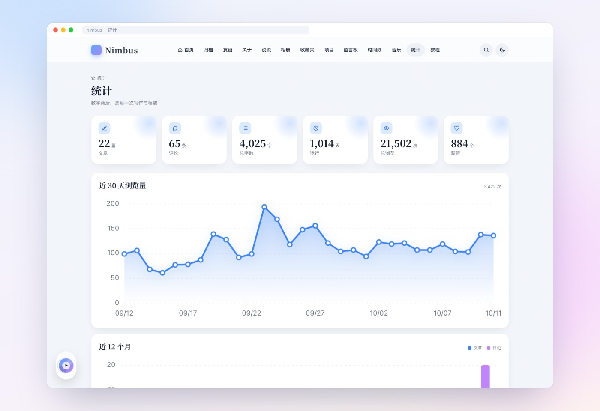
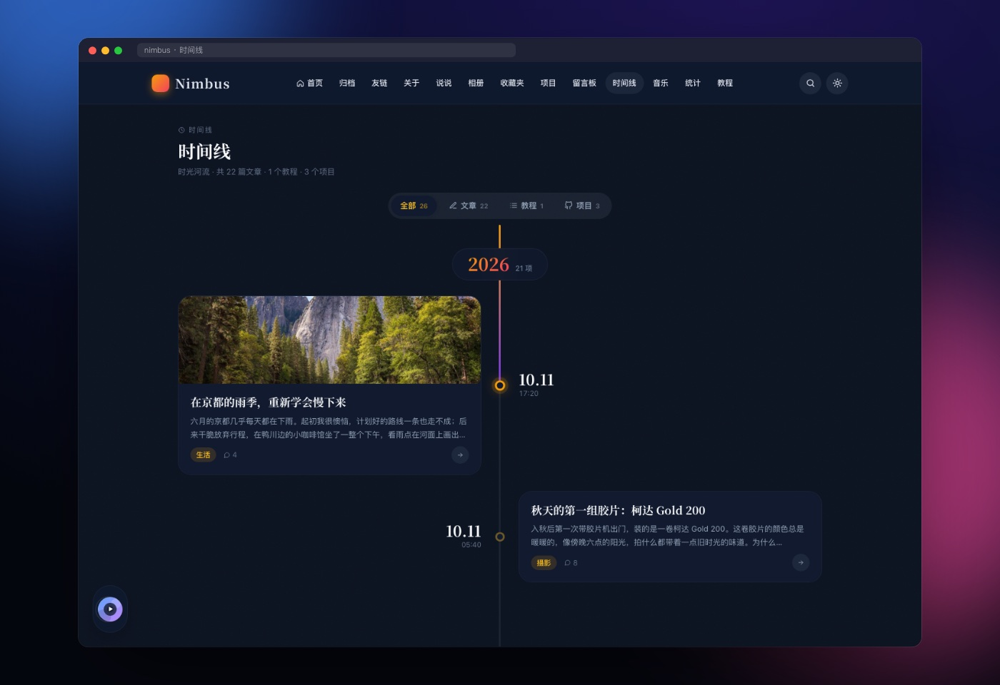
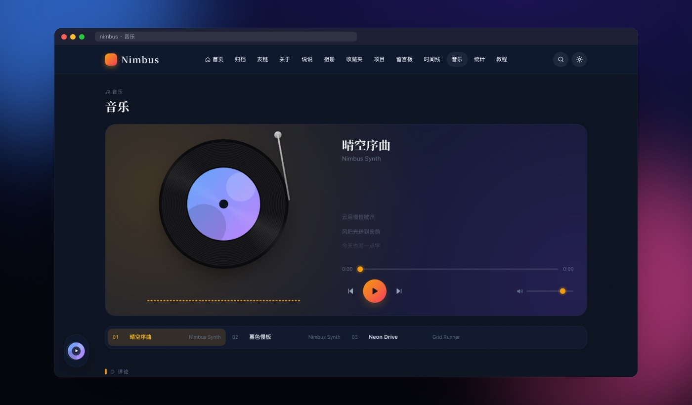

<p align="center">
  
</p>

<p align="center">
  
  
  
  
  
  
</p>

<p align="center">
  <b>Nimbus</b> 是一个开源免费的 Typecho 主题，配套插件 <b>NimbusKit</b>。<br>
  杂志风首页与文章页、三套皮肤、系列教程、统计看板、时间线、音乐播放器……上传即用，不需要任何构建步骤。<br>
  <sub>A magazine-style, zero-build Typecho theme with three skins, tutorials, stats, timeline and a companion plugin. MIT licensed.</sub>
</p>

<p align="center">
  <a href="#快速开始">快速开始</a> ·
  <a href="docs/install-typecho.md">安装 Typecho</a> ·
  <a href="#截图">截图</a> ·
  <a href="#功能一览">功能一览</a> ·
  <a href="docs/user-guide.md">使用手册</a> ·
  <a href="Nimbus/CHANGELOG.md">更新日志</a>
</p>

---

## 三套皮肤，一键切换


**晴空**适合白天，**暮色**适合夜间，**赛博朋克**带代码雨、霓虹描边和标题故障特效。可以跟随系统深浅色自动切换，首屏不闪烁；皮肤只是一组 CSS 变量，想自己配色直接改变量即可。

## 亮点

- **杂志级首页**：极光封面、超大渐变标题、随鼠标倾斜的 3D 文章卡片堆、分类滚动条、Bento 精选网格。Hero 背景可以设成**每日必应壁纸**，每天自动换图。
- **沉浸式阅读**：封面舞台 + 悬浮正文卡片，左侧操作栏、右侧浮动目录、编号小标题、引言式引用；代码高亮、KaTeX 公式、Mermaid 图表、图片灯箱一应俱全。
- **系列教程**：把一个分类设为教程，首页出现课程卡片和学习进度，分类页变成课程目录，文章页带章节导航。
- **统计看板**：浏览趋势、月度发文与评论、分类分布、写作热力图；热力图点一下就能看当天写了什么。
- **时间线**：文章、教程、项目汇成一条纵向时间河流，可按类型筛选。
- **全站音乐播放器**：切换页面不断播，音乐页有黑胶唱片、频谱和滚动歌词。
- **快**：样式合并为单文件、脚本模块预加载、无刷新页面切换（View Transitions），本地首页首屏 0.2 秒内。
- **零构建、零依赖**：仓库里的文件就是运行文件，不需要 Node、Composer 或打包工具；不装插件主题也完整可用。

## 截图



<p align="center"><sub>赛博朋克皮肤的文章页。背景字符雨是一行行真实的 Python / Go / Rust 代码，竖着读就是代码。</sub></p>

<table>
  <tr>
    <td width="50%"><p align="center"><b>Bento 精选</b><br><sub>精选文章、作者、写作节奏、最新说说、正在播放</sub></p></td>
    <td width="50%"><p align="center"><b>阅读体验</b><br><sub>悬浮正文卡片、操作栏、右侧目录、表格与引用</sub></p></td>
  </tr>
  <tr>
    <td><p align="center"><b>系列教程</b><br><sub>课程封面、章节目录、学习进度</sub></p></td>
    <td><p align="center"><b>统计看板</b><br><sub>手写 SVG 图表，随皮肤配色</sub></p></td>
  </tr>
  <tr>
    <td><p align="center"><b>时间线</b><br><sub>年份吸顶、左右交错、中轴随滚动点亮</sub></p></td>
    <td><p align="center"><b>音乐</b><br><sub>黑胶唱片、频谱、LRC 歌词，与悬浮播放器共用</sub></p></td>
  </tr>
</table>

### 手机上同样好看


## 功能一览

<table>
  <tr><th width="50%">Nimbus 主题（单独可用）</th><th width="50%">NimbusKit 插件（可选，装上自动点亮）</th></tr>
  <tr valign="top"><td>

- 三套皮肤，可跟随系统，也可固定一套
- 杂志 / 经典两种首页，三种列表样式
- 分页 / 滚动加载 / 加载更多（后台设置）
- 杂志 / 沉浸 / 经典三种文章布局
- 浮动目录、阅读进度、字数与阅读时长
- 代码高亮（行号、复制、折叠）、KaTeX、Mermaid
- 系列教程、教程进度记忆
- 评论：楼中楼、表情、Markdown 预览
- 页面模板：归档、友链、关于、留言板、时间线、音乐、统计、教程、404
- 短代码：提示框、折叠、标签页、按钮、视频、B 站、GitHub 卡片、回复可见
- 分享海报（带二维码，可下载）
- 每日必应 Hero 背景
- 赛博朋克特效、Live2D 看板娘（可选）
- 中英双语前台，配置导入 / 导出
- 无刷新切换、搜索弹窗（Ctrl/Cmd+K）、SEO

</td><td>

- 浏览量（6 小时去重）与点赞
- 即时搜索，边输边出结果
- AJAX 评论，失败保留输入
- 邮件通知（内置 SMTP，SSL / STARTTLS）
- 说说：文字 + 多图动态
- 友链、相册、收藏夹（网址导航）、项目展示
- GitHub 登录评论，可设「仅 GitHub 用户可评论」
- 评论者 IP 属地（离线 ip2region 库）
- 每日浏览量，供统计看板画趋势
- `/sitemap.xml`
- 后台「管理 → Nimbus」统一面板
- 不依赖主题：换主题后数据保留

</td></tr>
</table>

## 快速开始

### 还没有 Typecho？

Nimbus 运行在 [Typecho](https://typecho.org) 上，先把 Typecho 装好：

1. 准备 PHP 7.4+ 和一个数据库（MySQL / SQLite / PostgreSQL 任选；用 MySQL 需先建好空库）。
2. 从 [Typecho 发布页](https://github.com/typecho/typecho/releases) 下载 `typecho.zip`，解压到网站根目录，并让 PHP 对该目录可写。
3. 给 Web 服务器配好伪静态（Nginx 的 `try_files`、Apache 的 `.htaccess` 或 Caddy 的 `php_fastcgi`）。
4. 浏览器打开 `https://你的域名/install.php`，按向导填写数据库信息与管理员帐号。
5. 后台「设置 → 永久链接」启用地址重写。

每一步的命令、Nginx / Apache / Caddy 配置示例和常见报错，见 **[Typecho 安装教程](docs/install-typecho.md)**。

### 安装到你的博客

1. 下载本仓库（`git clone` 或 GitHub 上的 Download ZIP）。
2. 把 `Nimbus/` 复制到 Typecho 的 `usr/themes/Nimbus`，目录名必须是 `Nimbus`。
3. 后台「控制台 → 外观」启用 Nimbus，在「设置外观」里按需配置。
4. （可选）把 `NimbusKit/` 复制到 `usr/plugins/NimbusKit`，在「控制台 → 插件」启用。启用时自动建表，重复启用安全，禁用默认保留数据。

常用页面（归档、友链、统计、时间线、教程……）在后台新建独立页面时选对应模板即可，详见[主题说明](Nimbus/README.md#页面模板)。

### 本地预览

```bash
bash tests/serve.sh
```

需要 PHP 7.4+（含 `pdo_sqlite`）与 curl。首次运行会自动下载并安装 Typecho 1.2.1，启用 NimbusKit 并灌入示例数据。打开 http://localhost:8099 预览，后台在 `/admin/`（admin / admin123）。

## 环境要求

| 项目 | 要求 |
| --- | --- |
| Typecho | 1.2.1 及以上 |
| PHP | 7.4 – 8.5 |
| 数据库 | MySQL / MariaDB、SQLite、PostgreSQL（插件三种都已实测） |
| 浏览器 | 近两年的 Chrome、Edge、Safari、Firefox；不支持 View Transitions 的浏览器自动退回普通切换 |

## 文档

| 文档 | 内容 |
| --- | --- |
| [Typecho 安装教程](docs/install-typecho.md) | 从零搭建 Typecho：环境、上传、伪静态、安装向导、常见报错 |
| [使用手册](docs/user-guide.md) | 安装步骤、常见问题、性能建议 |
| [主题说明](Nimbus/README.md) | 配置速查、页面模板、短代码、自定义字段、皮肤定制 |
| [插件说明](NimbusKit/README.md) | 功能、安装、邮件 / GitHub 登录 / IP 属地配置、接口、数据与卸载 |
| [更新日志](Nimbus/CHANGELOG.md) | 各版本变化 |
| [路线图](docs/ROADMAP.md) | 已完成与计划中的功能 |

## 目录结构

```text
Nimbus/       主题本体 → usr/themes/Nimbus
NimbusKit/    配套插件 → usr/plugins/NimbusKit
docs/         使用手册、设计文档、路线图、截图
tests/        本地测试站、单元测试、冒烟测试、截图脚本
```

## 参与开发

主题使用原生 ES 模块与 CSS 层叠层（cascade layers），改完文件刷新即可看到效果。提交前请跑一遍：

```bash
bash tests/lint.sh && bash tests/lint-php74.sh && php tests/run.php && node --test tests/js/*.test.mjs && bash tests/smoke.sh
```

改了 CSS 源文件后运行 `php tests/build-css.php` 重新生成合并样式。更多说明见[主题说明 · 开发与测试](Nimbus/README.md#开发与测试)。欢迎提 Issue 和 Pull Request。

## 致谢

- 设计灵感来自 Cuteen 主题，Nimbus 的代码完全独立实现。
- 随主题分发的第三方库：Prism、KaTeX、Mermaid、Noto Serif SC，许可证见 `Nimbus/assets/vendor/*/LICENSE` 与 `Nimbus/assets/fonts/LICENSE.txt`。
- IP 属地数据格式来自 [ip2region](https://github.com/lionsoul2014/ip2region)，数据文件需自行下载。
- 截图中的风景照片来自必应每日壁纸与 Unsplash，仅作演示。

## 许可

[MIT](LICENSE) © 2026 Nimbus Contributors
